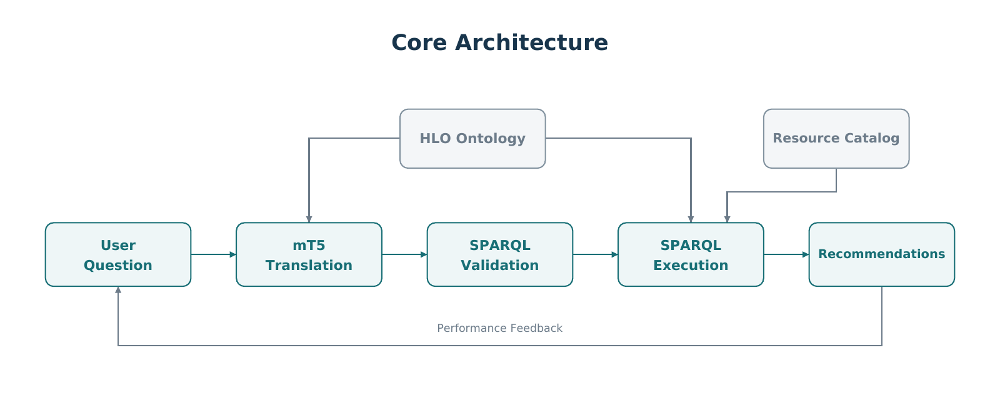

# HLO Recommender

Research implementation of ontology-grounded mT5 query generation, BKT mastery tracking, gap detection, and context-aware resource ranking.



## Gradio and Hugging Face Spaces

```bash
python -m pip install -r requirements.txt
python app.py
```

Use the URL printed in the terminal. For Hugging Face, create a Gradio Space and copy the project source into the Space repository root. The YAML above selects the SDK and entry point. Keep `app.py`, `styles.css`, `README.md`, `requirements.txt`, and `pyproject.toml` at the root alongside `src/`, `configs/`, `data/`, and `examples/`. The app loads `configs/default.toml`, its ontology and catalog inputs, and `examples/results/bkt_model.json`.

The demo runs on CPU using the SPARQL template and the included BKT model fitted on synthetic data. Practice history is simulated in memory for each request. The recommendation time limit applies to individual resources.

## Setup

```bash
python -m venv .venv
python -m pip install -e .
python -m unittest discover -s tests -v
hlo inspect
```

Activate the environment before installation. Use `pip install -e ".[model]"` for mT5 and Dueling Double DQN.

## Run

```bash
hlo data validate --directory data/development
hlo demo --output artifacts/demo/run-001
hlo experiment --config configs/experiment.toml
hlo recommend --generator template --question "Find resources for arterial blood gas interpretation" --level Junior --minutes 15
```

The template generator is an explicit baseline. mT5 inference requires a fine-tuned checkpoint.

## Train

```bash
hlo download --model google/mt5-small --output artifacts/base/mt5-small
hlo train mt5 --config configs/mt5.toml
hlo train bkt --config configs/bkt.toml
hlo train policy --config configs/policy.toml
```

Research configurations expect reviewed files under `data/reviewed`. To test training on synthetic examples:

```bash
hlo train mt5 --config configs/mt5.development.toml --allow-synthetic --check-only
hlo train mt5 --config configs/mt5.development.toml --allow-synthetic
hlo train bkt --config configs/bkt.development.toml --allow-synthetic
```

## Evaluate

```bash
hlo evaluate queries --generator mt5 --checkpoint artifacts/mt5/run-001/checkpoint --data data/reviewed/questions.test.jsonl --output artifacts/evaluation/queries-001
hlo evaluate bkt --model artifacts/bkt/run-001/model.json --data data/reviewed/assessments.test.jsonl --output artifacts/evaluation/bkt-001
hlo experiment --config configs/experiment.toml --generator both --checkpoint artifacts/mt5/run-001/checkpoint --output artifacts/experiments/mt5-001
```

Use a new output directory for each run. Checkpoints, histories, predictions, metrics, input hashes and environment versions are saved together.

## Layout

```text
configs/              Model, runtime and experiment settings
data/ontology/        Original HLO LLM ontology and source hash
data/development/     Synthetic resources, questions and assessments
data/reference/       Preserved results from the supplied project
docs/                 Data contracts and experimental protocol
examples/results/     Executed development checks and experiments
src/hlo_recommender/  Models, pipeline, training and evaluation
tests/                Functional and methodological checks
```

The ontology is preserved byte for byte. The resource catalog is separate and uses a declared duration extension. Development data and saved development results are synthetic. Pretrained and fine-tuned mT5 weights are not distributed. Dueling Double DQN is an optional transition-based experiment and is not enabled in the default recommendation pipeline.

## Documentation

[Research Methodology](docs/methodology.md) · [Data Contracts](docs/data_contracts.md) · [Experimental Protocol](docs/experiments.md) · [Notebook Workflows](Notebook/README.md) · [Ontology Experiment](Notebook/Colab/HLO-Colab-Training.ipynb) · [Duplication Audit](docs/duplication-audit.md)
