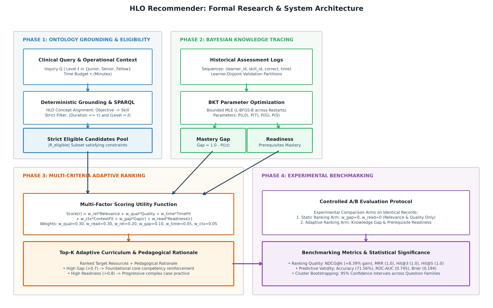

# Research Methodology

This document outlines the formal methodology and system architecture implemented in `hlo_recommender`. The pipeline addresses context-aware educational resource retrieval and adaptive ranking over the Healthcare Learning Ontology (HLO).

## 1. Problem Formulation

Let $Q$ denote a clinical learning inquiry, $C = (\ell, \tau)$ an operational context comprising training level $\ell \in \{\text{Junior}, \text{Senior}, \text{Fellow}\}$ and available duration $\tau \in \mathbb{Z}^+$, and $\mathcal{R}$ the catalog of available educational resources. For a learner $u$, the objective is to retrieve and rank an optimal subset $\mathcal{R}^* \subseteq \mathcal{R}$ that satisfies deterministic curricular constraints while adapting to the learner's current mastery state $\mathbf{m}_u$.

The framework separates deterministic eligibility from adaptive ranking:

$$\mathcal{R}^* = \operatorname{arg\,top}_k \left( \{ r \in \mathcal{R}_{\text{eligible}} \mid \text{Score}(r, C, \mathbf{m}_u) \} \right)$$

## 2. Ontology Grounding and Resource Eligibility

Deterministic retrieval is enforced through SPARQL queries executed over the combined HLO ontology graph $\mathcal{G}_{\text{onto}}$ and resource catalog $\mathcal{G}_{\text{cat}}$.

A clinical query $Q$ is grounded to target skill classes $\mathcal{S}_Q \subset \mathcal{V}_{\text{HLO}}$. Candidate resources must satisfy the explicit path:

$$\text{LearningResource} \xrightarrow{\text{supportsObjective}} \text{Objective} \xrightarrow{\text{requiresCompetency}} \text{Competency} \xrightarrow{\text{developsSkill}} s \in \mathcal{S}_Q$$

Subject to strict filter constraints:
1. **Level Constraint:** $\exists v : (r, \text{hlo:recommendedFor}, v) \wedge (v, \text{rdf:type}, \text{hlo:}\ell)$
2. **Time Constraint:** $\text{ext:estimatedDurationMinutes}(r) \le \tau$

Resources failing either constraint are pruned prior to scoring.

## 3. Bayesian Knowledge Tracing (BKT)

Learner mastery is tracked using standard Bayesian Knowledge Tracing (Corbett & Anderson, 1994). For each skill $s$ and sequential assessment step $t$, the latent mastery state is $L_t \in \{0, 1\}$.

The model is parameterized by $\theta = (P(L_0), P(T), P(G), P(S))$:
* $P(L_0)$: Initial mastery prior.
* $P(T)$: Transition (learning) probability: $P(L_{t+1}=1 \mid L_t=0)$.
* $P(G)$: Guess probability: $P(\text{Correct}_t=1 \mid L_t=0)$.
* $P(S)$: Slip probability: $P(\text{Correct}_t=0 \mid L_t=1)$.

The predicted response probability is:

$$P(\text{Correct}_t) = P(L_t)(1 - P(S)) + (1 - P(L_t))P(G)$$

Posterior updates given observed binary outcome $o_t \in \{0, 1\}$ follow Bayes' rule:

$$P(L_t \mid o_t=1) = \frac{P(L_t)(1 - P(S))}{P(\text{Correct}_t)}$$

$$P(L_t \mid o_t=0) = \frac{P(L_t)P(S)}{1 - P(\text{Correct}_t)}$$

The updated state for the subsequent step is:

$$P(L_{t+1}) = P(L_t \mid o_t) + (1 - P(L_t \mid o_t))P(T)$$

Parameter estimation is performed via bounded L-BFGS-B maximum likelihood across multi-start initializations on learner-disjoint assessment sequences.

## 4. Mastery Gap and Pedagogical Readiness

For each eligible resource $r$, two learner-adaptive features are derived from the current mastery vector $\mathbf{m}_u$:

1. **Mastery Gap:**
   $$\text{Gap}(r, \mathbf{m}_u) = \frac{1}{|\mathcal{S}_r|} \sum_{s \in \mathcal{S}_r} (1 - P(L_{t, s}))$$
   where $\mathcal{S}_r$ denotes the skills covered by resource $r$.

2. **Pedagogical Readiness:**
   Let $\mathcal{P}_r$ denote the declared prerequisite skills for resource $r$. If $\mathcal{P}_r \neq \emptyset$:
   $$\text{Readiness}(r, \mathbf{m}_u) = \frac{1}{|\mathcal{P}_r|} \sum_{p \in \mathcal{P}_r} P(L_{t, p})$$
   If $\mathcal{P}_r = \emptyset$, $\text{Readiness}(r, \mathbf{m}_u) = 1.0$.

## 5. Multi-Criteria Ranking Function

Eligible candidates are scored via a linear utility combination:

$$\text{Score}(r) = w_{\text{rel}} f_{\text{rel}} + w_{\text{qual}} f_{\text{qual}} + w_{\text{time}} f_{\text{time}} + w_{\text{ctx}} f_{\text{ctx}} + w_{\text{gap}} \text{Gap}(r) + w_{\text{read}} \text{Readiness}(r)$$

Where:
* $f_{\text{rel}}$: Ontology relevance score $[0, 1]$.
* $f_{\text{qual}}$: Curated instructional quality rating $[0, 1]$.
* $f_{\text{time}}$: Normalized duration fit within the allocated budget $\tau$.
* $f_{\text{ctx}}$: Contextual alignment score with level $\ell$.
* Standard weights: $w_{\text{qual}} = 0.30$, $w_{\text{read}} = 0.30$, $w_{\text{rel}} = 0.20$, $w_{\text{gap}} = 0.10$, $w_{\text{time}} = 0.05$, $w_{\text{ctx}} = 0.05$.

In the static baseline arm ($w_{\text{gap}} = 0, w_{\text{read}} = 0$), ranking reflects only fixed resource properties and clinical relevance.

## 6. Experimental Evaluation Protocol

The evaluation protocol benchmarks retrieval fidelity and ranking efficacy:

1. **Query Generation:** Evaluated on SPARQL syntax validity, execution validity, and answer-set F1 against reference queries.
2. **Mastery Tracking:** Evaluated prequentially on held-out learners using binary cross-entropy (Log Loss), Brier score, Area Under ROC curve (AUC), and binned calibration.
3. **Ranking Comparisons:** Evaluates Top-1, Hit@3, Hit@5, MRR, MAP@k, and NDCG@k between static and adaptive arms. Statistical confidence intervals (95%) are obtained via cluster bootstrapping resampled over question families.
